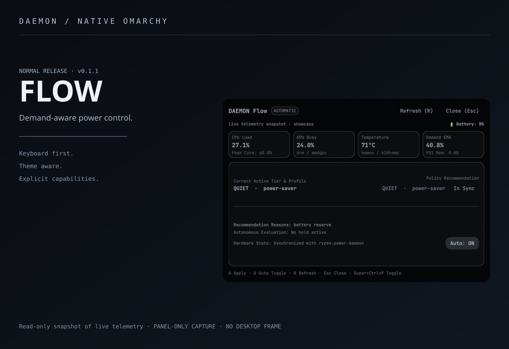

# DAEMON Flow



[Full-size panel](assets/panel.png) · [Capture provenance](assets/PROVENANCE.md)

Measured demand, deliberate power changes. Native Omarchy controls backed by your **existing Ryzen power owner**, with fast upshifts, slower downshifts and manual choices that stay held.

**Release:** v0.1.1 · normal release, scoped to the documented custom backend. Not a universal laptop power manager or a per-process watt allocator.

## What works

- System-wide CPU and busiest-core demand, GPU utilization, temperature and battery telemetry.
- CPU, memory and I/O pressure diagnostics; disk/RAM stalls alone do not request Extreme.
- Standard after2seconds of sustained demand, Extreme after12seconds of heavy demand on AC, and60seconds of light-work dwell before Quiet. Downshifts also observe30seconds minimum duration.
- Verified serial changes through the current hardware owner. Flow acknowledges its own changes; they no longer become false manual holds.
- Persistent external/manual hold, explicit **Resume Auto**, and Auto toggle. New installs default to Auto off.
- Thermal protection at80°C with5°C recovery hysteresis; battery reserve and unknown-temperature limits. Existing hardware protections remain authoritative.

## Required backend

Python3, `powerprofilesctl` and an existing compatible `/run/ryzen-power.sock` are required. That socket belongs to the customized `ryzen-power-daemon`; it is **not supplied by standard Arch or power-profiles-daemon**. Flow does not install it or compete with it. See [the backend contract](docs/POWER_OWNER.md). Without it, the panel reports telemetry unavailable and performs no automatic changes.

## Install

```sh
omarchy plugin add https://github.com/aarushdalal/daemon-flow --enable
omarchy plugin validate ~/.config/omarchy/plugins/daemon0.flow
omarchy-shell shell toggle daemon0.flow
```

The manager may choose a different checkout directory; validate the path printed by `omarchy plugin list`. Enable Auto in the panel only after confirming the backend and its watt/thermal envelopes. A manual profile change pauses automation until Resume Auto or an explicit Auto off/on cycle.

## Keyboard and diagnostics

Suggested shortcut, added to your existing Lua bindings after checking conflicts:

```lua
o.bind("SUPER + CTRL + P", "DAEMON Flow", "omarchy-shell shell toggle daemon0.flow")
```

Within the panel: R refresh, A apply the current advisory when Auto is off, U toggle Auto, Esc close. The Resume Auto button releases a held manual choice.

```sh
omarchy-shell flow status
omarchy-shell flow pause
omarchy-shell flow resume
```

`resume` enables Auto and clears its manual hold. Settings: `~/.config/omarchy/flow.json` (`schema`, `autoApply`, `manualHold`). Never expose the local hardware-owner socket over the network.

## Development and validation

```sh
python3 -m unittest discover -s tests -p 'test_*.py'
python3 tests/native_service_probe.py  # needs installed Quickshell; offscreen, no hardware writes
python3 monitor.py --samples 3 --interval 2  # actual read-only sampling
```

26portable unit tests, plus3host deployment/rollback tests in the integration workspace, passed. Native offscreen hold/resume/file-watch tests and real owner transitions/manual-hold/resume passed on the development machine. One controller process observed. No universal reduction in lag, acoustic improvement, battery-life gain or optimal thresholds is claimed. Unrelated shell IPC restart observed during acceptance preserved Auto settings; no Flow crash was established.

## Troubleshooting and rollback

- No escalation: check Auto, manual hold, temperature and `flow status` reasons. Hot or low-battery conditions deliberately limit the recommendation.
- CPU remains low while work is slow: inspect pressure reasons; disk/RAM stalls and nice/cgroup priority cannot be solved by watt changes alone.
- Socket missing: install/configure your existing compatible owner separately; Flow has no generic fallback hardware writer.
- Disable with `omarchy plugin disable daemon0.flow`; disable Auto first with `omarchy-shell flow pause`. The current hardware profile is preserved. To downgrade, restore your prior checkout/settings backup while unlocked, then validate and enable it. Do not overwrite a later manual power selection.

[Security](SECURITY.md) · [Third-party notices](THIRD_PARTY.md) · [Changelog](CHANGELOG.md)
## Compatibility and installation safety

Requires the native Omarchy **Quattro/Quickshell plugin API** providing `qs.Ui`, `qs.Commons`, panel/service injection and native plugin management. Quickshell alone or older Omarchy releases are not sufficient. Tested on one Arch Linux/Hyprland/Omarchy installation; other versions are unverified. Keep the existing theme synchronization system: these panels consume native theme tokens.

Install/update only while the session is unlocked. Native plugin graph reloads can unload lock surfaces on the tested shell; these repos do not fix that host bug. Back up existing plugin/settings files, inspect the diff, and validate before enabling. No graphical-session restart, package installation or privileged setup is performed by this repository.
