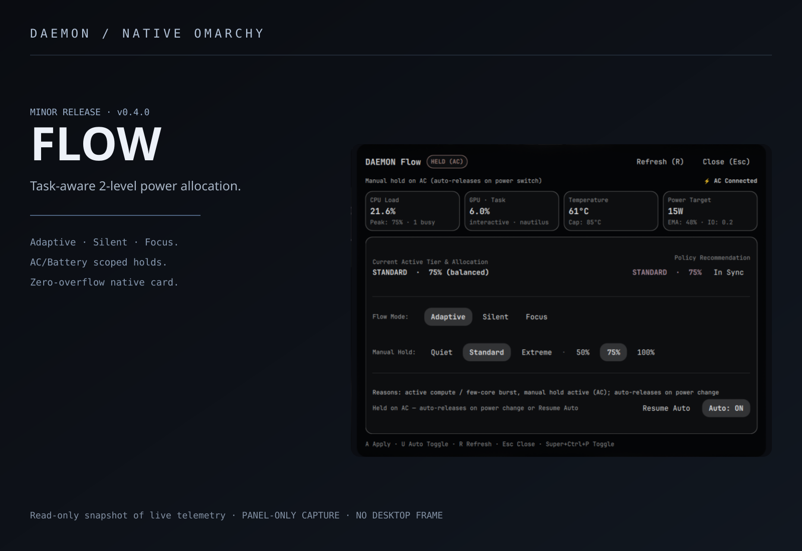

# DAEMON Flow



[Full-size panel](assets/panel.png) · [Capture provenance](assets/PROVENANCE.md)

Measured, task-aware demand and deliberate 2-level power allocation. Native Omarchy controls backed by your **AMD Ryzen platform**, with fast upshifts, slower downshifts, operating modes, and AC/Battery-scoped manual holds.

**Release:** v0.3.0 · engineered for AMD Ryzen APUs/CPUs with AMD Radeon Graphics.

---

## What works

- **2-Level Power Allocation**: Uses the full `Tier` (`Quiet` / `Standard` / `Extreme`) × `Allocation` (`50%` / `75%` / `100%`) matrix — scaling across `Quiet · Power-Saver` (8W), `Quiet · Balanced` (11W), `Standard · Balanced` (15W), `Standard · Performance` (20W AC / 16W Bat > 30%), and `Extreme · Performance` (25W AC).
- **Hybrid Telemetry & Task Classification**:
  - Tracks aggregate CPU, busiest core, per-core concurrency (`busy_cores` >= 60%), GPU busy %, separated `iowait`, multi-sensor CPU temperatures, and scoped system battery telemetry (`scope: Device` peripherals filtered out).
  - Bounded `/proc/<pid>/stat` task scan distinguishes foreground compute/compile/GPU jobs from `nice >= 10` background indexers (which are capped at `Standard · Balanced`).
  - Reads CPU, memory, and I/O PSI (`some.avg10`); disk/RAM stalls alone do not request `Extreme`.
- **Flow Operating Modes**:
  - **Adaptive**: Full 2-level task-aware scaling.
  - **Silent**: Capped inside the `Quiet` tier (`50%` / `75%` / `100%`).
  - **Focus**: Minimum `Standard · Balanced` floor with faster `Extreme` escalation on AC.
- **Fast Upshifts, Stable Cooldowns**: `Standard` floor in **2s**, `Standard · Performance` in **4s**, `Extreme · Performance` in **6s** on AC (`4s` in `Focus`), and **60s** light-work dwell / **25s** downshift minimum duration to avoid fan oscillation.
- **Graduated Thermal Step-Down**:
  - `>= 90°C`: steps down from `Extreme` (25W) to `Standard · Performance` (20W), recovering at `<= 85°C`.
  - `>= 93°C`: steps down to `Standard · Balanced` (15W), recovering at `<= 88°C`.
  - `>= 96°C`: emergency drop to `Quiet · Power-Saver` (8W), recovering at `<= 91°C`.
- **Power-Source-Scoped Manual Hold & Resumption**: Manual tier/profile selections latch only for the active power source (`AC` or `Battery`), automatically releasing when AC/Battery state changes, and surface a `HELD (AC)` / `HELD (BAT)` badge + notification until **Resume Auto** or power change.
- **Dual-Backend Support**:
  - **Full Custom Mode (Best Experience)**: Pairs with `/run/ryzen-power.sock` (`ryzen-power-daemon`) for direct SMU wattage clamping and AMDGPU DPM tuning.
  - **Universal Fallback Mode**: Gracefully drives Linux standard `powerprofilesctl` (`power-saver`, `balanced`, `performance`) when the custom socket is absent.

---

## Required Backend

1. **Custom Ryzen Mode**: Python 3, `powerprofilesctl` and a running `/run/ryzen-power.sock` (`ryzen-power-daemon`). See [the backend contract](docs/POWER_OWNER.md).
2. **Universal Linux Mode**: Python 3 and standard `powerprofilesctl` (`power-profiles-daemon`).

Flow does not require root privileges and performs no direct sysfs writes itself.

---

## Install

```sh
omarchy plugin add https://github.com/aarushdalal/daemon-flow --enable
omarchy plugin validate ~/.config/omarchy/plugins/daemon0.flow
omarchy-shell shell toggle daemon0.flow
```

The manager may choose a different checkout directory; validate the path printed by `omarchy plugin list`.

---

## Keyboard and Diagnostics

Suggested shortcut, added to your existing Lua bindings after checking conflicts:

```lua
o.bind("SUPER + CTRL + P", "DAEMON Flow", "omarchy-shell shell toggle daemon0.flow")
```

Within the panel: `R` refresh, `A` apply the current advisory when Auto is off, `U` toggle Auto, `Esc` close. Use the **Adaptive / Silent / Focus** mode buttons, quick **Tier / Allocation** buttons, or **Resume Auto** directly in the panel.

```sh
omarchy-shell flow status
omarchy-shell flow mode adaptive   # adaptive | silent | focus
omarchy-shell flow set standard performance
omarchy-shell flow pause
omarchy-shell flow resume
```

Settings are persisted at `~/.config/omarchy/flow.json` (`schema`, `autoApply`, `manualHold`, `manualHoldOnAc`, `flowMode`). Never expose the local hardware-owner socket over the network.

---

## Development and Validation

```sh
python3 -m unittest discover -s tests -p 'test_*.py'
python3 tests/native_service_probe.py  # needs installed Quickshell; offscreen, no hardware writes
python3 monitor.py --samples 3 --interval 2  # actual read-only sampling
```

34 unit and regression tests pass. Native offscreen hold/resume/file-watch probe passes on Quickshell.

---

## Troubleshooting and Rollback

- **No escalation**: Check Auto, `HELD (AC/BAT)` badge, temperature, and `omarchy-shell flow status` reasons. `Extreme` is intentionally AC-only and gated by thermal limits (`< 90°C`).
- **CPU remains low while work is slow**: Inspect pressure/`task_class` reasons; disk/RAM stalls and `nice >= 10` background tasks cap at `Standard`.
- **Disable plugin**: Run `omarchy plugin disable daemon0.flow`; disable Auto first with `omarchy-shell flow pause`. Current hardware profile is preserved.

[Security](SECURITY.md) · [Third-party notices](THIRD_PARTY.md) · [Changelog](CHANGELOG.md)

---

## Compatibility and Installation Safety

Requires the native Omarchy Quattro / Quickshell plugin API (`qs.Ui`, `qs.Commons`). Tested on Arch Linux / Hyprland / Omarchy with AMD Ryzen processors and AMD Radeon Graphics.
